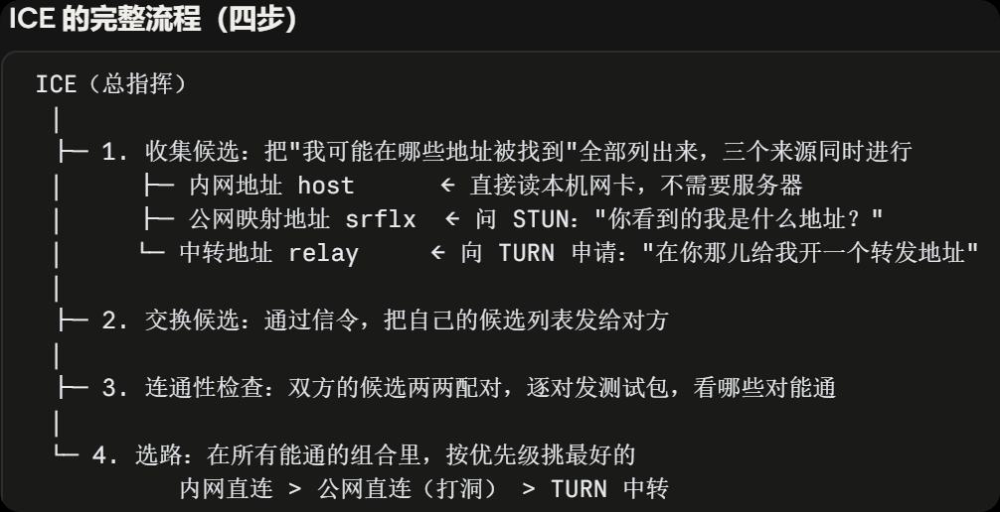
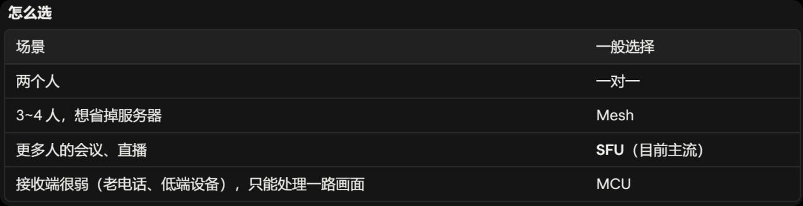
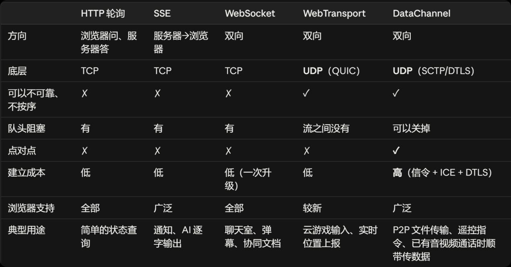

# WebRTC 学习笔记

> 由原始笔记 `original/WebRTC学习笔记.docx` 转换而来（2026-11-10）。

**基础介绍**

WebRTC 是浏览器里自带的一套"直接打电话"的本领。平时你在网页上发消息、看视频，数据一般都要先经过网站的服务器转一道。WebRTC 让两台设备尽量直接连起来，面对面地实时传声音、画面和文件，所以延迟低，也省了服务器的流量。为了做到这一点，它悄悄替你办了四件事：

1\. 先通过一个"中间人"互相报一下家门：我在哪、我支持什么格式。

2\. 想办法穿过家里路由器这类"门卫"，真正连上对方。实在连不上，就请一台服务器帮忙转发。

3\. 把通话内容加密，别人截到了也看不懂。

4\. 网络变卡时自动调整，比如把画质降一点、少等一会儿重发的数据，保证对话不卡顿、不延迟。

你用网页版视频会议、在浏览器里直接和别人视频通话，背后靠的往往就是它。

**一次WebRTC通话要经过哪些步骤：**

\[采集/编码\] → ①信令 → ②连接 → ③加密 → ④通信 → \[解码/播放\]

1.  信令：双方不知道对方在哪里、支持什么格式，所以双方先各写一份"自我介绍"互相交换，使用SDP格式（Session Description Protocol，会话描述协议），内容包括：

    ·我可能在哪些地址上被找到

    ·我要发几路音视频

    ·我支持哪些编解码器

    ·安全相关的参数

    通过信令服务器（WebRTC不管，需自己准备）送到对方手中。

2.  连接：找不到对方的真实地址（家用路由器会改写IP和端口，一只知道内网地址）

    解决办法分三层：

    ·STUN 服务器：一台放在公网上的服务器。A 问它"你看到的我是什么地址"，它回答 A 经过 NAT 之后的公网 IP 和端口。

    ·ICE：一套流程。把双方所有可能的地址都列出来，这些地址叫候选（candidate），比如内网地址、STUN 查到的公网地址；然后两两配对，逐对试能不能通，挑出一条能走的路。

    ·TURN 服务器：如果所有直连路径都不通（有些 NAT 或防火墙太严），就退一步，让一台公网服务器负责中转数据。代价是绕路，延迟增加，而且服务器要承担全部流量。

    

3.  加密：WebRTC 强制加密

    在第①步的SDP里，事先放上自己证书的指纹；握手时，检查出示的证书和信令里收到的指纹对不对得上。

4.  通信：

    · 音视频走 RTP（加密后叫 SRTP）。RTP 是专门为实时媒体设计的传输格式，跑在UDP上。书里说它最重要的一点是给开发者灵活性：延迟、丢包、拥塞都能自己决定怎么处理。

    · 任意数据走 DataChannel（数据通道），底层协议叫 SCTP。它的特点是可以按需关掉"可靠交付"和"按序交付"。

    **WebRTC的五个优势（来自第8章）**

|  |  |
|----|----|
| S1 浏览器内置 | 用户什么都不用装，有浏览器就能用（手机、电脑、智能电视都行） |
| S2 能穿过 NAT 直连 | 不需要服务器有公网地址，也不需要折腾路由器 |
| S3 低延迟，取舍可调 | 自动根据网速调整码率；DataChannel 可以选不可靠、不按序，避免队头阻塞 |
| S4 复用老协议 | 用的是 RTP、SDP 这些老牌协议，和传统设备对接起来很便宜 |
| S5 通用 | 视频会议、文件传输、游戏都用它，没法只封锁其中一种用途 |

关于 S2：没有 WebRTC 时，想从外面访问家里的一台设备，常见做法有两种：

·端口转发：在家里路由器上手动设一条规则，把某个端口收到的数据转给内网某台机器；

·固定公网 IP：向运营商申请一个固定的公网地址。

**使用场景**

1.  音视频为主的场景

    视频会议/直播推流，用到S1和S3（书里说它是 WebRTC 最初的用途；还特别指出 WebSocket 只有在网络条件理想时才好用）

2.  音视频 + 数据混合

    远程访问，S1、S2（被控电脑不需要公网地址）、S3（输入指令走不可靠通道，避开 TCP 的队头阻塞）。

3.  数据为主

    文件共享（浏览器之间直接传文件）/翻墙，S1、S2、S5（封锁 WebRTC 就等于连视频会议一起封了）。

    **拓扑（用户之间建立连接）**

<!-- -->

1.  一对一

2.  全网状（Full Mesh）：每个人和其他所有人都直连

|          |                  |                      |
|:--------:|:----------------:|:--------------------:|
|          |       5 人       |        20 人         |
|   上行   | 4 × 1.5 = 6 Mbps | 19 × 1.5 = 28.5 Mbps |
| 编码次数 |       4 份       |        19 份         |
|   下行   |      6 Mbps      |      28.5 Mbps       |

瓶颈有两个：上行带宽和编码算力，两者都随人数线性增长。20 人时，普通笔记本或手机根本扛不住。

Mesh最适合小群组。它的优点是完全不需要媒体服务器。

3.  混合网状：让别人帮忙转发

    不直接发给所有人，而是发给几个人，由他们接力转发给其他人。这样减轻了你的上行负担。代价是：

    ·每多转一跳，延迟就多一截；

    ·发送者不知道最后有谁收到、是否收到了。

4.  SFU（选择性转发单元）：一台服务器负责分发

    每个人只把自己的视频上传一份给服务器，服务器原样转发给其他人。

    服务器只转发，不解码、不重新编码，所以算力开销小，但服务器要承担大量带宽。

    "选择性"：服务器可以决定给谁转发什么，比如只转发正在说话的人的画面，或者给网差的人转发低清版本。

5.  MCU（多点会议单元）：服务器把大家拼成一个画面

    服务器把每个人的视频解码，拼成一个宫格画面，再重新编码成一路发给每个人。

    优点：下行只有一路（只收一路合成画面）。

    代价全部压在服务器上：要为每个人解码，还要重新编码，算力开销很大。重新编码也会再增加一点延迟，而且画面布局由服务器决定，客户端没法自由调整。

    

    **与其他技术的横向对比**

<!-- -->

1.  传消息/数据

<!-- -->

1.  **第一代 HTTP**

    短轮询（间隔大，且大部分询问都浪费）；

    长轮询（每条消息都要重新发起一次请求，而每次请求都要带上一堆 HTTP 头部，开销大）；

    SSE（服务器推送事件）：浏览器发一次请求，服务器保持这条连接不断开，持续往下推消息，只能单向（服务器 -\> 浏览器）；

2.  **第二代 WebSocket——一条长期的双向通道**

    先用一次 HTTP 请求"升级"连接，之后就变成一条长期保持、双向都能主动发的通道；

    目前做聊天室、弹幕、协同文档的标准答案。

    缺点：底层是TCP（对头堵塞）；需连服务器。

3.  第三代 WebTransport

    建立在 UDP 之上的新传输协议；

    一条连接里可以开多条互相独立的流，一条流丢包不会阻塞其他流，从而缓解队头阻塞；

    可以不可靠、不按序；

    缺点：必须连服务器，不能点对点；普及情况不如WebSocket；

    

<!-- -->

2.  
